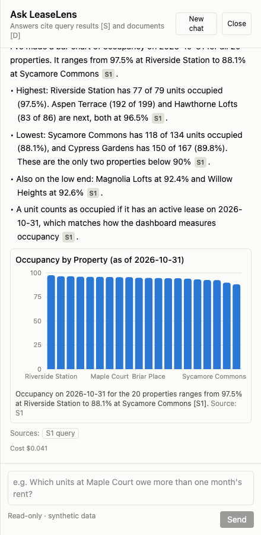

# LeaseLens

A property-management reporting platform with an AI agent that answers questions about portfolio data and documents. **All data is synthetic.** There are no real companies, people or properties.

> Work in progress. Data, KPIs, dashboard, document search and the AI agent are done; the weekly digest is next. The architecture diagram, benchmark table and limitations are filled in as later milestones land.


## Quickstart

Needs Docker Desktop.

```bash
cp .env.example .env
make demo          # build, start, migrate and seed → http://localhost:5173
```

API docs: http://localhost:8000/docs

## Development

```bash
make install       # uv (Python 3.11) + npm deps
make check         # ruff, mypy, eslint, tsc, pytest, vitest
```

## What's here so far

| Area | Details |
|---|---|
| Synthetic data | Seeded generator: 20 properties, 3,000 units, about 15.8k leases, 67k rent-ledger rows and 13k work orders over 24 months. Includes seasonality, January lateness, hardship and evictions, an HVAC heat-wave spike, and renewals driven by lateness, maintenance SLA, tenure and rent vs. market. |
| Schema | PostgreSQL with Alembic. A PII-free `reporting` schema is the only thing the read-only agent role can see. |
| KPI API | FastAPI endpoints for occupancy, rent roll, delinquency aging, lease expirations, NOI and work-order SLA, all with property, date and as-of filters |
| Dashboard | React, TypeScript, Vite, Tailwind and Recharts. Portfolio overview, property drill-down, URL-based filters, table view for every chart, dark mode. |
| Document search (RAG) | 150 synthetic property documents in Pinecone. Baseline: fixed 1,000-character chunks with dense search. Improved: section chunks with title headers plus cross-encoder reranking. Models run on CPU via fastembed (ONNX). Labels are verbatim evidence spans; `make bench-rag` reports bootstrap CIs and memory footprint. |

### RAG benchmark (from [BENCHMARKS.md](BENCHMARKS.md), 89 test questions)

| Method | Recall@5 | MRR@10 | nDCG@10 | p50 latency |
|---|---|---|---|---|
| Baseline (fixed chunks, dense) | 0.629 | 0.553 | 0.592 | 78 ms |
| Improved (section chunks + rerank) | 0.989 | 0.946 | 0.957 | 172 ms |

RAG needs `PINECONE_API_KEY` in `.env`; run `make ingest` then `make bench-rag`.

### AI agent: "Ask LeaseLens"



Claude with three tools: `query_kpis` (read-only text-to-SQL behind four safety layers), `search_documents` and `generate_report`. Answers stream with citations to query results [S#] (rows and SQL one click away) and document passages [D#]. Eval from [BENCHMARKS.md](BENCHMARKS.md) (`make eval-agent`, 23 cases):

| Correctness | Documents | Refusal | Injection | Faithfulness | Citations valid |
|---|---|---|---|---|---|
| 10/10 | 5/5 | 5/5 | 3/3 | 18/18 | 18/18 |

A small suite: no failures found at this size, not a zero failure rate. The agent needs `ANTHROPIC_API_KEY` in `.env`.

See [DECISIONS.md](DECISIONS.md) for design choices and [BENCHMARKS.md](BENCHMARKS.md) for measured results.
