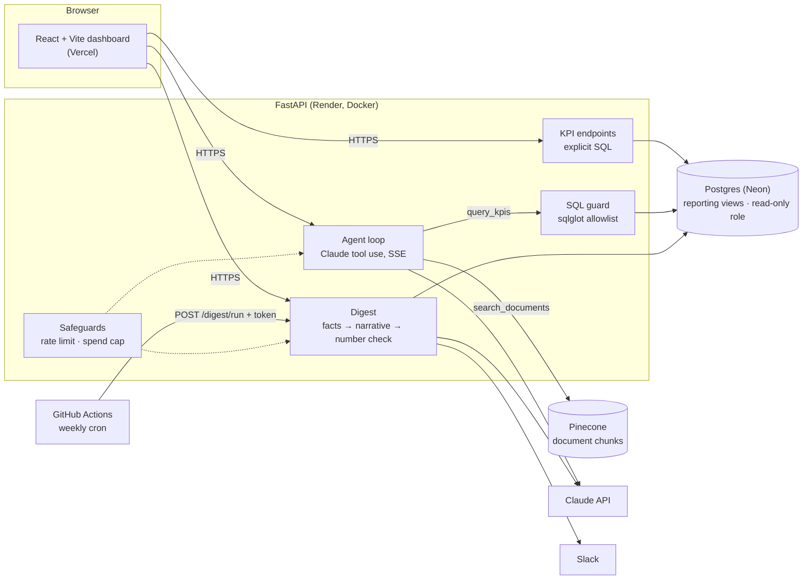

# LeaseLens

A property-management reporting app with an AI analyst and a weekly digest, built to show
**small, useful, finished** delivery through reviewed PRs. **All data is synthetic:** no real
companies, people or properties.

**Live demo: https://keystone-insights-nu.vercel.app.** The free API host sleeps when idle, so
the first visit can take up to a minute. AI answers are rate-limited and capped at $2/day; after
that, the suggested questions show recorded answers.


The look is architectural and quiet: charcoal and warm off-white, one bronze accent, a serif for
headings and figures, thin outline buttons, and one light section. Photos are free-licence
Unsplash images, credited in the site footer and below.

## What it does

| | |
|---|---|
| **Welcome page** | Says what the app is in one sentence, then shows four live "how is the portfolio doing?" cards in plain English (apartments rented, unpaid rent, leases ending soon, repairs done on time), each with a verdict (Healthy / Keep an eye on / Needs attention) and the rule behind it. |
| **Reporting dashboard** | Occupancy, NOI, delinquency aging, lease expirations, work-order SLA and rent roll for a 20-property portfolio, with property and date filters, a drill-down, and a table view for every chart. Every KPI is defined in plain SQL and tested against a hand-calculated fixture. |
| **"Ask LeaseLens" agent** | Claude answers ad-hoc questions with three tools: read-only text-to-SQL, document search over leases and SOPs, and charts. Every number cites its source: query results [S#] (with **Show SQL**) or document passages [D#]. |
| **Weekly digest** | Every Monday: delinquency week over week, leases expiring in 90 days, SLA breaches. The numbers come from SQL and Claude writes the summary. **Code checks every number in the summary against the data**; if one doesn't match, a facts-only version is sent instead. Delivered to Slack. |

## 60-second walkthrough

What to show and say, in order (it matches the GIF):

1. **Welcome page (10 s).** "This is the first thing a non-expert sees: what the app does, and four plain-English health checks with the rule behind each verdict. All the numbers are live."
2. **Dashboard and drill-down (15 s).** "Every tile says what it means in everyday words, with the industry term in brackets. Each one is a single SQL definition, tested against hand-worked numbers. Click a building to drill in."
3. **Ask LeaseLens (20 s).** Click a suggested question. "Claude writes the SQL, but it runs through a guard and as a read-only database role, so it can't change anything. Every number cites its source. Here's the exact SQL behind it." Open **Show SQL**.
4. **Weekly digest (15 s).** "Every Monday this goes to Slack. The model only writes the prose. Code checks every number against the SQL facts, and if any number doesn't match, the summary is withheld and a facts-only version goes out. In 10 test builds, all 10 summaries passed."

## Architecture



Search runs locally inside the API (fastembed/ONNX): BGE embeddings and a MiniLM cross-encoder
reranker, 376 MB serving footprint. Design decisions are in [DECISIONS.md](DECISIONS.md)
(D-001 to D-046).

## Quickstart

Needs Docker Desktop. The dashboard works with no keys; the agent needs `ANTHROPIC_API_KEY` and
`PINECONE_API_KEY` in `.env`.

```bash
git clone https://github.com/poojithamadhyala/keystone-insights.git && cd keystone-insights
cp .env.example .env      # add keys here (and only here)
make demo                 # build, start, migrate, seed → http://localhost:5173
make ingest               # one time: index the documents in Pinecone (for the agent)
make check                # lint, types, 88 Python + 34 web tests (what CI runs)
```

Deploying your own copy: [docs/deploy.md](docs/deploy.md).

## Results

Every number below is produced by a `make` target and copied from [BENCHMARKS.md](BENCHMARKS.md),
which records the command, dataset size, hardware and date for each.

**Document search** (`make bench-rag`, 89 test questions, 95% CIs in BENCHMARKS.md)

| Method | Recall@5 | MRR@10 | nDCG@10 | p50 latency |
|---|---|---|---|---|
| Baseline: fixed-size chunks, dense | 0.629 | 0.553 | 0.592 | 78 ms |
| Improved: section chunks + reranker | 0.989 | 0.946 | 0.957 | 172 ms |

**Agent** (`make eval-agent`, 23 cases, ground truth from SQL): correctness 10/10, document
answers 5/5, out-of-scope refusals 5/5, prompt-injection resistance 3/3, faithfulness 18/18,
valid citations 18/18. $0.015 per question; median 5.5 s.

**Digest** (`make bench-digest`): 10/10 summaries passed the number check ($0.207 for 10 builds).

**Accessibility** (`make bench-a11y`, Lighthouse): 100 on all four pages (welcome, dashboard,
drill-down, weekly summary).

## How I built this with Claude Code

I worked with Claude Code (Claude Opus 5.5) as a pair: it drafted code, tests and docs, and I
set direction, reviewed every PR and made the calls. The working agreement is written down in
[CLAUDE.md](CLAUDE.md), so the AI and any human contributor follow the same rules.

- **Shape before code.** Each feature started as a one-page shape doc ([docs/shaping/](docs/shaping/))
  with a time budget, what's out of scope, and go/no-go criteria. Scope was cut when it didn't fit
  (email delivery, feature store and graph RAG are `later` issues).
- **Small reviewed PRs.** Feature branch → PR with template → self-review comment → green CI →
  squash-merge → tagged release (v0.1.0 to v0.5.0, [CHANGELOG.md](CHANGELOG.md)).
- **Measure, don't claim.** Every metric comes from a `make` target. When the numbers were
  disappointing, they were reported anyway: hybrid BM25 search was built, measured as no better,
  and removed.
- **Where verification caught real problems**, some in the AI's own work:
  - The first agent eval reported failures that were **bugs in the scorer**, not the agent (for
    example, it flagged the agent for *correctly* reporting a prompt-injection attempt). The
    scorers were fixed with regression tests and the eval was re-run in full.
  - The digest's number check accepted "18%" because an unrelated fact said "18 days".
    Percentages now only match percentage facts.
  - On Neon (non-superuser Postgres) the agent's read-only role switch would have failed on
    every query. This was found **before deploying** by reproducing the setup locally, and is now
    covered by a test.
  - API keys pasted into a committed file were caught before any commit. A secret scan now runs
    in CI, in `make check` and as a pre-commit hook, and CI scans the web bundle too.

## Limitations

- **Synthetic, templated data.** Documents share layouts, so retrieval scores are optimistic in
  absolute terms (comparisons between methods still hold).
- **Small eval suites** (89 retrieval questions, 23 agent cases, 10 digest builds): passing
  everything means no failure was found at this size, not a zero failure rate. The 25-item human
  spot-check of the retrieval labels is still pending.
- **Single-instance demo:** agent conversations and rate limits live in memory and reset on
  restart. The spend cap is in Postgres, but requests already in flight can overshoot it slightly.
- **No authentication.** The demo is public and read-only by design. CORS is hygiene, not
  security; the rate limits and spend cap are the protection.
- **The number check is untyped for money vs. counts:** "$18" could match an unrelated "18 days".
- **Slow cold start on the free tier:** 32.6 s and 27.4 s to the first response after idle (two
  samples). Render memory isn't measured yet (382 MiB in local Docker). Accessibility is automated
  checks only; no manual screen-reader testing yet.

## Future work

Tracked as GitHub issues labeled `later`: email delivery for the digest; a renewal-risk model
with a feature store; graph RAG over a Neo4j knowledge graph; drift monitoring and alerting;
batch embedding at scale. See also [docs/domo.md](docs/domo.md) for how the dashboard would be
published as a Domo custom app.

## Credits

Photos from [Unsplash](https://unsplash.com) under the Unsplash licence: Roman (@rm_reins; hero
facade, balconies), Mohammadreza Charkhgard (lit window), Matei C (@moritura23; curtains) and
Ksenia Obukhova (@fez_wee; house model). Fonts: Marcellus and Jost (Google Fonts, SIL OFL).

## Repo map

`api/` FastAPI (KPIs, agent, digest, safeguards) · `web/` React dashboard · `data/` generator +
migrations · `rag/` document search · `evals/` benchmarks and eval sets · `prompts/` versioned
prompts · `docs/` operator brief, shaping docs, deploy guide · `infra/` Docker, scripts
