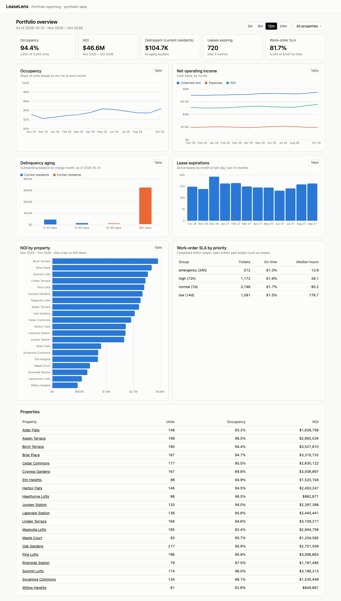

# LeaseLens

A property-management reporting platform with an AI agent that answers questions about portfolio data and documents. **All data is synthetic.** There are no real companies, people or properties.

> Work in progress. Milestone 1 (data, KPIs, dashboard) is done. The architecture diagram, benchmark table and limitations are filled in as later milestones land.



## Quickstart

Needs Docker Desktop.

```bash
cp .env.example .env
make demo          # build, start, migrate and seed → http://localhost:5173
```

API docs: http://localhost:8000/docs

## Development

```bash
make install       # uv (Python 3.11) + npm deps
make check         # ruff, mypy, eslint, tsc, pytest, vitest
```

## What's here so far

| Area | Details |
|---|---|
| Synthetic data | Seeded generator: 20 properties, 3,000 units, about 15.8k leases, 67k rent-ledger rows and 13k work orders over 24 months. Includes seasonality, January lateness, hardship and evictions, an HVAC heat-wave spike, and renewals driven by lateness, maintenance SLA, tenure and rent vs. market. |
| Schema | PostgreSQL with Alembic. A PII-free `reporting` schema is the only thing the read-only agent role can see. |
| KPI API | FastAPI endpoints for occupancy, rent roll, delinquency aging, lease expirations, NOI and work-order SLA, all with property, date and as-of filters |
| Dashboard | React, TypeScript, Vite, Tailwind and Recharts. Portfolio overview, property drill-down, URL-based filters, table view for every chart, dark mode. |

See [DECISIONS.md](DECISIONS.md) for design choices and [BENCHMARKS.md](BENCHMARKS.md) for measured results.
